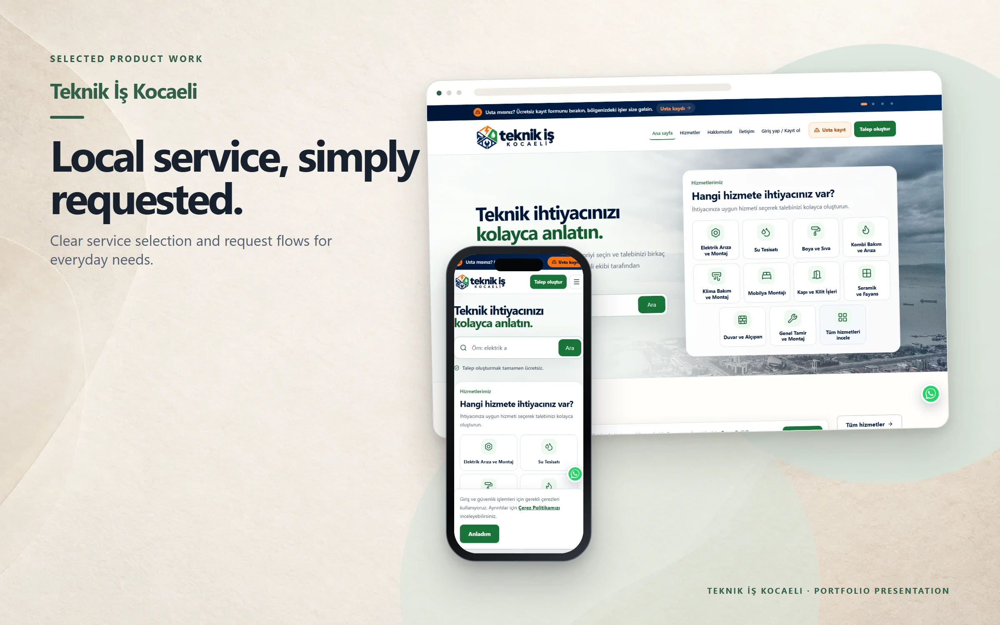
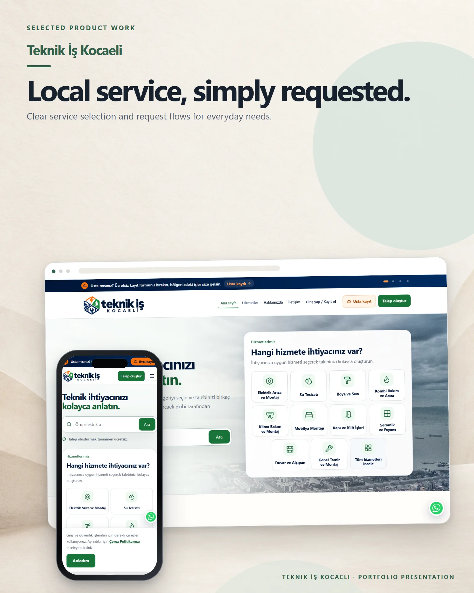

# Teknik İş Kocaeli

A local service-request platform that helps people describe technical work and reach the right service category.

**Live:** [teknikiskocaeli.com](https://teknikiskocaeli.com) &nbsp;·&nbsp; **More work:** [github.com/mertomeroglu](https://github.com/mertomeroglu)

### Highlights

- Search-led service selection across common repair categories
- Guided request flow with optional photos
- Professional registration and customer account entry points
- District-focused responsive experience for Kocaeli

### Built with

Next.js · React

---

Presentation-only repository: this README and two presentation images built from real product screens. Application source and private configuration are not published here. Visual content and brand assets remain the property of their respective owners — see [LICENSE](LICENSE).
