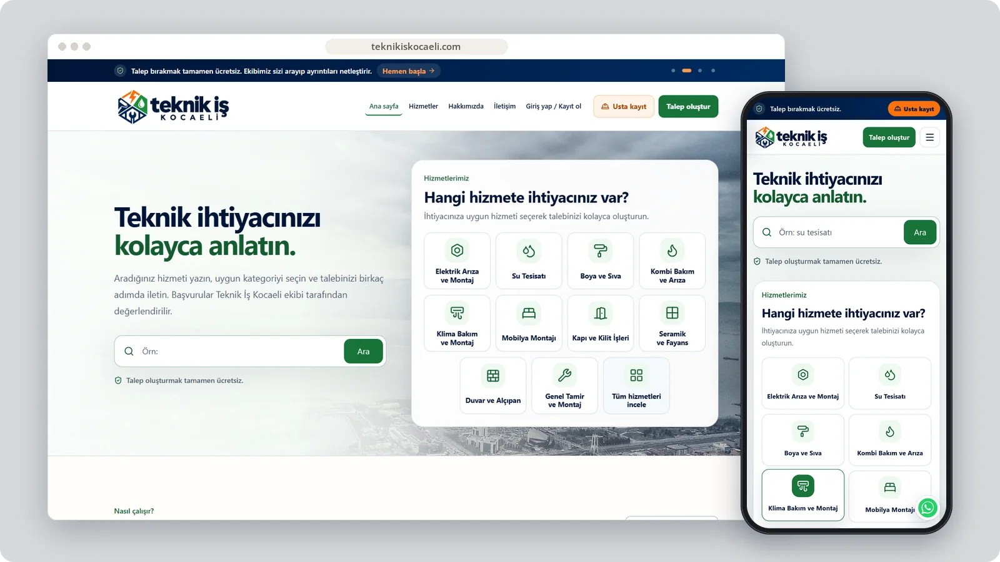
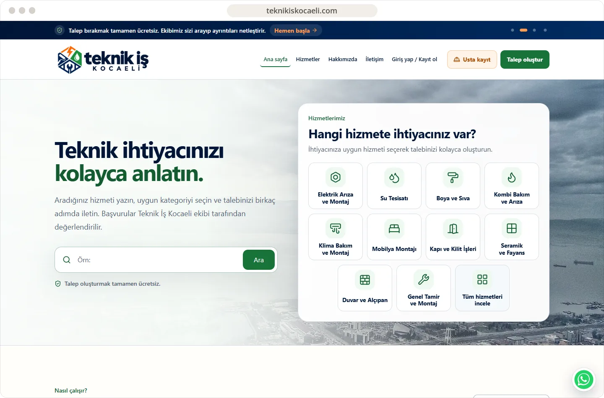
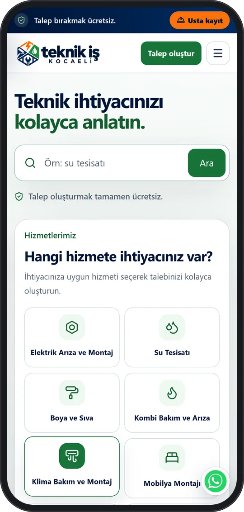

# Teknik İş Kocaeli

A local service-request platform that helps people describe technical work and reach the right service category.

**[Visit teknikiskocaeli.com ↗︎](https://teknikiskocaeli.com)** &nbsp;·&nbsp; [More work by Mert Ömeroğlu](https://github.com/mertomeroglu)

### Highlights

- Search-led service selection across common repair categories
- Guided request flow with optional photos
- Professional registration and customer account entry points
- District-focused responsive experience for Kocaeli

### Built with

Next.js · React

### Screens

---

Presentation-only repository. Images are real, unmodified product screens in a simple frame; application source and private configuration are not published here. Brands and visual content belong to their respective owners — see [LICENSE](LICENSE).
